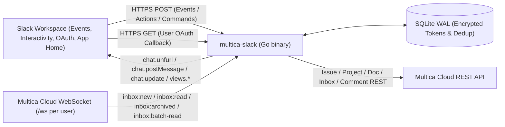

# Multica Slack App (`multica-slack`) — Design Specification

**Date:** 2026-11-26  
**Repository:** `github.com/everlightlabs/multica-slack`

---

## 1. Intent & Why

Pasting a Multica Cloud link (for example `https://multica.ai/acme/issues/ACME-42`) into Slack falls back to Multica's generic marketing Open Graph card ("Multica — Project Management for Human + Agent Teams") because issue pages are authenticated. At the same time, Multica inbox events (`@mentions`, assignments, comments, status handoffs, failed agent runs) stay inside Multica's web UI unless checked manually.

`multica-slack` solves both problems for a self-hosted Slack workspace:

1. **Rich link unfurling** across channels and 1:1 / group DMs, replacing the generic marketing card with compact, GitHub-style vertical-bar cards showing live issue, project, or doc metadata.
2. **Jira-style Slack DM notifications**, streaming each teammate's personal Multica inbox into their Slack app DM with direct `Open in Multica`, `Mark Read`, and `Reply` actions.

---

## 2. Goals, Non-Goals, and Anti-Goals

### Goals
- Unfurl `multica.ai` issue, project, and doc links in public channels, private channels, and 1:1 / group DMs.
- Deliver near-real-time personal DM notifications via each linked teammate's Multica `/ws` `inbox:new` stream, backed by `/api/inbox` catch-up on startup and reconnect.
- Provide self-serve Slack App Home and `/multica` controls to connect/disconnect a Multica PAT (`mul_...`), switch workspaces, authorize per-user DM/uninvited-channel unfurling, and toggle notification preference groups.
- Support direct interactive DM actions (`Mark Read`, `Reply`) authenticated as the acting Multica user, and keep Slack DM read-state in sync when items are read or archived in Multica.
- Ship as a clean, standalone, open-source Go Docker repository (`multica-slack`).

### Non-Goals (v1)
- Replacing Multica's built-in per-agent Slack chat bot (chatting with agents or `/issue` chat flows).
- Channel-level project subscriptions or shared-channel activity firehoses (v1 is personal DM notifications + link unfurling).
- Mutating issue status, assignee, priority, or creating issues from Slack (v1 interactive mutations are limited to `Mark Read` and posting a `Reply` comment).
- Multi-tenant public Slack App Directory SaaS hosting (each deployment targets one Slack workspace, configurable via environment variables for any self-hoster).

### Anti-Goals
- **Leaking private-project data:** Never fetch an issue, project, or doc using another user's PAT. A link is always fetched with the posting user's PAT (or an operator-configured `MULTICA_FALLBACK_PAT` if explicitly enabled).
- **Notification spam:** Never flood Slack with historical unread inbox items on first link, workspace switch, unpause, or toggling a preference group ON; never duplicate notifications across WebSocket reconnects or restarts; keep low-signal events (reactions, field metadata tweaks, new issue creation) muted by default.
- **Secret exposure:** Never store plaintext Multica PATs or Slack user OAuth tokens on disk, never log tokens or comment bodies at info level, and never commit deployment secrets into the repository.

---

## 3. Verified External Contracts & Constraints

### Multica Cloud (`https://api.multica.ai`, `https://multica.ai`)
Verified against `multica-ai/multica` server source:

- **No user-facing outbound webhooks.** Real-time events come over an outbound WebSocket to:
  `wss://api.multica.ai/ws?workspace_id=<uuid>&client_platform=multica-slack&client_version=<ver>`
- **WebSocket first-frame auth:** Within 10 seconds of upgrade, send:
  ```json
  { "type": "auth", "payload": { "token": "mul_..." } }
  ```
  and expect `{"type":"auth_ack"}`. Invalid/revoked tokens receive an `auth_error` / `error` frame and close.
- **WebSocket heartbeats:** Server sends RFC 6455 `Ping` frames every 54s (`pongWait = 60s`) and also supports client JSON `{"type":"ping"}` -> `{"type":"pong"}`. Client responds to RFC 6455 pings automatically and sends `{"type":"ping"}` every 30s, reconnecting if no `{"type":"pong"}` arrives within 10s.
- **WebSocket event envelopes:**
  - All server events use `{ "type": "<event>", "payload": {...}, "actor_id": "...", "actor_type": "..." }`.
  - `inbox:new` (personal, `SendToUser`): `payload.item` is an `InboxItemResponse`.
  - `inbox:read` (personal): `payload = { "item_id": "<uuid>", "recipient_id": "<uuid>" }`.
  - `inbox:archived` (personal): `payload = { "item_id": "<uuid>", "issue_id": "<uuid|null>", "recipient_id": "<uuid>" }`.
  - `inbox:batch-read` (personal — triggered by "mark all read"): `payload = { "recipient_id": "<uuid>", "count": <n> }` (no item IDs).
- **REST API auth & headers:** `Authorization: Bearer <pat>` plus `X-Workspace-ID: <workspace_id>` on workspace-scoped routes.
- **`GET /api/inbox`:** Returns a single JSON array (`InboxItemResponse[]`, bounded server-side by `inbox.ActiveLimit`, no cursor pagination required). Each item already embeds:
  - Core: `id`, `workspace_id`, `recipient_id`, `type`, `severity`, `title`, `body` (capped to 200 chars in list responses), `read`, `archived`, `created_at`
  - Issue metadata: `issue_id`, `issue_identifier` (e.g. `ACME-42`), `issue_status`, `issue_priority`, `issue_project_id`, `issue_assignee_type`, `issue_assignee_id`, `issue_due_date`, `issue_label_ids`
  - Actor: `actor_type`, `actor_id`, `details` (raw JSON)
  - Because issue status/priority/project ID/identifier and actor IDs are embedded, rendering DM cards needs **zero per-notification issue REST calls** — only cached workspace lookup maps (`members`, `agents`, `projects`, `issue-statuses`).
- **Other REST endpoints used:**
  - Identity & workspaces: `GET /api/me`, `GET /api/workspaces`
  - Unfurl lookups: `GET /api/issues/{id}` (supports UUID and issue identifier; if a non-UUID path ever returns 400/404, fall back to `GET /api/issues/search?q={identifier}` exact case-insensitive match), `GET /api/projects/{id}`, `GET /api/projects/{id}/progress`, `GET /api/docs/{id}`
  - Workspace metadata cache: `GET /api/workspaces/{id}/members`, `GET /api/agents`, `GET /api/projects`, `GET /api/issue-statuses`, `GET /api/squads`
  - Interactive mutations: `POST /api/inbox/{id}/read`, `POST /api/issues/{id}/comments` (body `{ "content": "<text>" }`)

### Slack Platform
- **Events API 3-second ack:** Slack requires `200 OK` within 3 seconds on Events API, interactivity, and slash commands. Multica fetches and `chat.unfurl` calls run asynchronously after immediate acknowledgment.
- **Bot vs. user `link_shared` scope:**
  - Bot-level `link_shared` fires in channels where the bot is a member.
  - User-level `link_shared` (requiring per-user OAuth scopes `links:read` + `links:write`) fires across **all** conversations the authorizing user is in — including 1:1 DMs, group DMs, private channels, and uninvited public channels.
  - **Attribution & privacy rule:** Always fetch Multica data using `event.user`'s (the link poster's) PAT — or `MULTICA_FALLBACK_PAT` if configured — never another user's PAT. For calling `chat.unfurl`, try the bot token first using `unfurl_id` + `source` (falling back to `channel` + `ts`); if Slack returns `channel_not_found`, `not_in_channel`, or `cannot_unfurl_url` (e.g. a 1:1 DM), retry `chat.unfurl` using `event.user`'s stored `xoxp-` token, or if `event.user` hasn't completed DM OAuth, the authorizing user's (`authorizations[0].user_id`) `xoxp-` token solely as transport to attach the unfurl (still rendering only data fetched with `event.user`'s PAT).
  - **Event deduplication:** Deduplicate in-memory with a 30-second TTL key `(channel, message_ts, url)`, releasing claimed keys if zero cards are produced or `chat.unfurl` fails.
- **Signature verification:** Verify `X-Slack-Signature` and `X-Slack-Request-Timestamp` (5-minute replay window) on every `/slack/*` POST route.

---

## 4. Approaches Considered

|Approach|Summary|Trade-offs|Decision|
|-|-|-|-|
|**1. Self-hosted Go Docker service**|Always-on Go static binary in a minimal `distroless` container holding persistent per-user Multica `/ws` connections + public HTTPS behind a reverse proxy + encrypted pure-Go SQLite on a mounted volume.|~15MB RAM, instant real-time WS delivery, zero cold starts, matches Multica's own Go stack, mature `slack-go/slack` library, and fast multi-arch static builds without CGO.|**Selected**|
|**2. Managed PaaS container (e.g. Render)**|Identical Go container deployed as an always-on Web Service + persistent disk / Postgres.|Zero host ops and built-in HTTPS, with recurring SaaS cost (free tiers idle and drop WS).|Drop-in fallback (same Dockerfile)|
|**3. Serverless Worker + Durable Objects**|Worker handles Slack HTTP Events + OAuth; DO holds Multica sync + SQLite.|Near-$0 serverless, but DO hibernation only covers inbound WS — outbound WS bills active DO time or degrades to 30–60s polling.|Rejected|

**Language choice (Go over Rust):** Both compile to tiny static binaries with low memory usage. Go wins for this app because Multica itself is written in Go (exact parity on JSON/WS conventions), `slack-go/slack` is mature and covers Events API, `chat.unfurl`, OAuth v2, Block Kit, App Home, and modals cleanly, `modernc.org/sqlite` gives CGO-free cross-compilation, and stdlib covers `crypto/aes` + `crypto/cipher` (AES-256-GCM), `log/slog`, and `net/http`.

---

## 5. System Architecture



### Core Modules
1. **HTTP / Slack Ingress Layer:** Serves Slack Events API (`/slack/events`), interactivity (`/slack/interactions`), slash commands (`/slack/commands`), OAuth (`/slack/oauth/start`, `/slack/oauth/callback`), and health endpoints (`/healthz`, `/readyz`). Enforces Slack HMAC signing on all `/slack/*` POST routes and optional `SLACK_ALLOWED_TEAM_ID` check.
2. **Multica Client & Metadata Cache:** Typed HTTP client wrapping Multica REST endpoints with per-user PATs, plus a short-TTL (60s) in-memory cache keyed by `workspace_id` (for members, agents, squads, projects, custom issue statuses) and by `slack_user_id` (for accessible workspace slug -> ID maps).
3. **Unfurl Service:** Matches registered `multica.ai` URLs, resolves the workspace and PAT, deduplicates duplicate `link_shared` deliveries, fetches live metadata, formats Slack vertical-bar cards, and calls `chat.unfurl`.
4. **Multica WebSocket Manager & Inbox Syncer:** Maintains one persistent `wss://api.multica.ai/ws` connection per active linked user, runs reconnect backoff, performs bounded `/api/inbox` catch-up on startup/reconnect, deduplicates deliveries, and updates DM read state on `inbox:read` / `inbox:archived` / `inbox:batch-read`.
5. **App Home & Interactive Handler:** Renders the per-user App Home view, handles PAT connect/workspace-switch/disconnect modals, notification toggle updates, and DM button actions (`Mark Read`, `Reply`).
6. **Encrypted SQLite Store:** Persists user records, encrypted credentials (AES-256-GCM), notification delivery/dedup records (including serialized card blocks for read-state updates), and short-lived OAuth CSRF states.

---

## 6. Feature Specifications

### 6.1 Link Unfurling

#### Supported URL Patterns & Multi-Workspace Resolution
Configured against `MULTICA_APP_URL` (default `https://multica.ai`). Strip trailing slashes, query parameters, and fragments before matching.

- **Multi-workspace unfurling:** When a linked user pastes a link from *any* Multica workspace their PAT can access (not just their selected notification workspace), resolve `{slug}` dynamically via their cached `GET /api/workspaces` map and fetch the resource from that workspace.

|Pattern|Resource|Multica API Lookup|
|-|-|-|
|`/{slug}/issues/{identifierOrUuid}`|Issue|`GET /api/issues/{identifierOrUuid}` with `X-Workspace-ID` (fallback: `GET /api/issues/search?q={identifier}` exact match)|
|`/{slug}/projects/{projectId}`|Project|`GET /api/projects/{projectId}` + `GET /api/projects/{projectId}/progress`|
|`/{slug}/docs/{docId}`|Doc|`GET /api/docs/{docId}`|

Unrecognized `multica.ai` paths (marketing root, settings, login) are ignored silently (no `chat.unfurl` call).

#### Visual Card Design (GitHub-style Vertical Accent Bar)
Rendered via Slack `chat.unfurl` attachment objects (`color` + Block Kit `blocks`, with plain-text `fallback`):

- **Issue card:**
  - Accent color by `status_category` / `status`:
    - `unstarted` (`backlog`, `todo`): `#94A3B8` (slate)
    - `started` (`in_progress`): `#3B82F6` (blue)
    - Handoff / `in_review` / `blocked` / custom started status: `#F59E0B` (amber)
    - `done` / `closed`: `#22C55E` (green)
    - `cancelled`: `#6B7280` (gray)
  - Title line: **`<url|ACME-42 — Issue Title>`**
  - Description preview: plain text stripped of heavy Markdown syntax, truncated to ~200 characters (omitted if empty).
  - Compact 2-column fields (`mrkdwn`): `Status`, `Assignee` (member, agent, squad, or Unassigned), `Priority`, `Project`.
  - Context footer: `Updated <relative time>` (plus up to 3 label names if present).
- **Project card:** Accent `#6366F1`, linked project name, description snippet (~200 chars), progress summary (completed / total issues), status.
- **Doc card:** Accent `#8B5CF6`, linked doc title, plain-text excerpt (~200 chars), updated relative time.

Up to 5 unique matching links per `link_shared` event are fetched concurrently and returned in a single `chat.unfurl` call.

---

### 6.2 Real-Time Per-User DM Notifications

#### WebSocket Lifecycle & Pause/Resume Semantics
- One `MulticaUserStream` per user with `multica_pat_enc IS NOT NULL`, `auth_status = 'ok'`, and `notifications_enabled = 1`.
- **Pause/Resume & Preference-Toggle No-Backfill Rule:** Items that arrive while notifications are paused or while a preference group is toggled OFF stay permanently suppressed — unpausing or turning a group back ON never replays old items.
  - On **initial PAT connect**, **workspace switch**, or **Resume Notifications**: capture `now` before snapshotting, snapshot all current unread `GET /api/inbox` IDs into `delivered_notifications` with `delivery_status = 'seeded'` (`slack_message_ts = NULL`), advance `notify_after = now`, then start/restart WS.
  - While **connected**, if a live or catch-up item belongs to a muted preference group, record `(slack_user_id, inbox_item_id)` with `delivery_status = 'skipped'` so turning that group ON later will not backfill it.
  - On **Pause Notifications**: close the user's WS cleanly; on **Resume**, run the snapshot + advance `notify_after = now` before reopening WS.
- **Reconnect & Auth Failure:**
  - Transient disconnects retry with exponential backoff + jitter (1s -> 2s -> 4s ... capped at 60s).
  - Auth failures (`auth_error` / `error` or HTTP `401` / `403`) stop retrying immediately, set `auth_status = 'auth_failed'`, and send **one** Slack DM prompting the user to update their PAT in App Home.
- **Startup & Reconnect Catch-Up:**
  - On every WS `auth_ack`, call `GET /api/inbox`, filter to items where `read = false`, `archived = false`, and `created_at >= max(user.notify_after, now - 24h)`, and pass them through the same preference + `INSERT OR IGNORE` dedup pipeline as live `inbox:new` events.
  - If Slack `chat.postMessage` fails transiently, delete the newly inserted `delivered_notifications` row so the next catch-up retries.

#### Read-State Sync from Multica
- `inbox:read` (`item_id`) and `inbox:archived` (`item_id`): look up matching `delivered_notifications` row where `delivery_status = 'delivered'` and `marked_read_at IS NULL`; call `chat.update` using stored `card_blocks_json` transformed via `MarkBlocksRead` to replace `[Mark Read]` with `✓ Read` and set `marked_read_at = now`.
- `inbox:batch-read` (no item IDs): immediately mark all unread rows read in SQLite, then asynchronously (off the WS reader goroutine) update via `chat.update` up to the 20 most recent unread delivered Slack DMs from the last 7 days with ~100ms spacing.

#### Notification Preference Groups
Mapped 1:1 to Multica's `server/internal/inbox/registry.go`:

|Group Key|Label in App Home|Multica Inbox Types|Default|
|-|-|-|-|
|`mentions`|Mentions|`mentioned`, `doc_mentioned`|ON|
|`assignments`|Assignments|`issue_assigned`, `unassigned`, `assignee_changed`|ON|
|`comments`|Comments|`new_comment`, `doc_comment`|ON|
|`status_changes`|Status changes|`status_changed`|ON|
|`agent_activity`|Agent activity & failures|`task_failed`, `app_action_result`|ON|
|`system_alerts`|Action-required & workspace alerts|`app_action_requested`, `app_action_reminder`, `app_connect_requested`, `children_done`, `blockers_done`, `autopilot_paused`, `autopilot_quota_exceeded`, `app_tool_calls_quota_exceeded`, `issue_subscribed`, `quick_create_failed`, `quick_create_done`, `quick_create_unconfirmed`, `project_owner_joined`|ON|
|`updates`|Issue field updates|`priority_changed`, `start_date_changed`, `due_date_changed`|OFF|
|`new_issues`|New issues|`issue_created`|OFF|
|`reactions`|Emoji reactions|`reaction_added`|OFF|

Unknown future Multica inbox types default to `system_alerts` (delivered) so newly added Multica alerts are never silently swallowed.

#### Slack DM Card & Interactive Actions
- **Body:**
  - Header line: **`<Actor Name>`** `<action verb>` **`<url|ACME-42>`** — `<Issue Title>` (actor resolved from cached members/agents, falling back to `actor_type`).
  - Quote/snippet: `item.body` (escaped for Slack mrkdwn, truncated to ~300 chars) when present.
  - Context line: `<Project> · <Status> · <Priority>`.
- **Action buttons:**
  - `Open in Multica` — link button to `https://multica.ai/{workspaceSlug}/issues/{issueIdentifier}` (or `/docs/...` for doc items).
  - `Mark Read` — calls `POST /api/inbox/{inbox_item_id}/read` using the user's PAT, sets `marked_read_at = now`, and updates the DM via `chat.update` to replace the button with `✓ Read`.
  - `Reply` (when `issue_id` is present) — opens a Slack modal (`views.open`) showing the issue identifier/title and a multiline comment field. On submit, calls `POST /api/issues/{issue_id}/comments` (`{ "content": "<text>" }`) with the user's PAT, marks the inbox item read (`POST /api/inbox/{inbox_item_id}/read`), updates the card to `✓ Read` if still unread, and posts a threaded reply under the DM card confirming the comment was posted.

---

### 6.3 Onboarding, App Home, Workspace Switching & Disconnect

- **App Home (`app_home_opened`):**
  1. **Multica Account section:**
     - Shows connected identity (`Connected as Alice Smith · acme (WS: connected)`), `PAT invalid — please reconnect`, or `Not connected`.
     - `[Connect PAT]` / `[Update PAT]` opens a modal collecting the `mul_` token, verified via `GET /api/me` + `GET /api/workspaces`. Rotating a PAT preserves the user's currently selected workspace when still accessible.
     - If the user belongs to >1 Multica workspace, shows a **Notification Workspace** selector directly in App Home (auto-selecting `MULTICA_DEFAULT_WORKSPACE_SLUG` or their first workspace on initial link). Changing workspace snapshots the new workspace's unread inbox, advances `notify_after`, and switches the WS stream without requiring disconnect.
     - `[Disconnect]` closes the user's WS, clears `multica_pat_enc`, `slack_user_token_enc`, and Multica identity columns, and sets `auth_status = 'disconnected'` — **preserving `notification_prefs_json`** so reconnecting keeps their toggles.
  2. **1:1 DM & Uninvited-Channel Unfurling section:**
     - Shown as Step 2 in App Home (enabled once the user has connected a PAT, or immediately if `MULTICA_FALLBACK_PAT` is set).
     - Displays `Enabled` or a `[Enable DM & Channel Unfurling]` button pointing to `https://<PUBLIC_BASE_URL>/slack/oauth/start?token=<signed_short_lived_token>` which initiates Slack OAuth (`links:read,links:write`) and saves the encrypted `xoxp-` token on callback.
  3. **Notification Preferences section:**
     - Master `[Pause Notifications]` / `[Resume Notifications]` toggle plus checkboxes for the 9 preference groups.
- **`/multica` slash command:**
  - `/multica` or `/multica connect` — opens the PAT connect modal.
  - `/multica status` — returns an ephemeral status summary (Multica WS state, selected workspace, DM unfurling OAuth state, enabled categories).

---

## 7. Data Model & Security

### SQLite Schema (`PRAGMA journal_mode = WAL; PRAGMA foreign_keys = ON;`)
- `users`:
  - `slack_user_id TEXT PRIMARY KEY`
  - `slack_team_id TEXT NOT NULL`
  - `slack_dm_channel_id TEXT`
  - `multica_user_id TEXT` (nullable when disconnected or OAuth-only)
  - `multica_user_name TEXT`
  - `multica_workspace_id TEXT`
  - `multica_workspace_slug TEXT`
  - `multica_pat_enc TEXT` (nullable AES-256-GCM: `v1:<iv_b64>:<tag_b64>:<ct_b64>`)
  - `slack_user_token_enc TEXT` (nullable AES-256-GCM `xoxp-` token)
  - `notification_prefs_json TEXT NOT NULL`
  - `notifications_enabled INTEGER NOT NULL DEFAULT 1`
  - `auth_status TEXT NOT NULL DEFAULT 'disconnected'` (`ok` | `auth_failed` | `disconnected`)
  - `notify_after TEXT` (ISO-8601 watermark updated on link, workspace switch, and resume)
  - `updated_at TEXT NOT NULL`
- `delivered_notifications`:
  - `slack_user_id TEXT NOT NULL`
  - `inbox_item_id TEXT NOT NULL`
  - `delivery_status TEXT NOT NULL` (`delivered` | `skipped` | `seeded`)
  - `issue_id TEXT`
  - `slack_channel_id TEXT`
  - `slack_message_ts TEXT`
  - `card_fallback TEXT`
  - `card_blocks_json TEXT`
  - `marked_read_at TEXT`
  - `created_at TEXT NOT NULL`
  - `PRIMARY KEY (slack_user_id, inbox_item_id)`
  - Daily background prune deletes rows older than 30 days.
- `oauth_states`:
  - `state TEXT PRIMARY KEY`
  - `slack_user_id TEXT NOT NULL`
  - `expires_at TEXT NOT NULL` (10-minute TTL, deleted on consume; expired rows pruned daily).

### Configuration (Environment Variables)
- `PORT` (default `3020`)
- `PUBLIC_BASE_URL` (e.g. `https://multica-slack.example.com`)
- `DATA_DIR` (default `/data`, holds `multica-slack.db`)
- `ENCRYPTION_KEY` (32-byte base64 key for AES-256-GCM; process fails fast on startup if missing or invalid)
- `SLACK_BOT_TOKEN` (`xoxb-...`)
- `SLACK_SIGNING_SECRET`
- `SLACK_CLIENT_ID` & `SLACK_CLIENT_SECRET` (for per-user OAuth)
- `SLACK_ALLOWED_TEAM_ID` (optional safety lock restricting incoming events/OAuth to a single Slack workspace)
- `MULTICA_API_URL` (default `https://api.multica.ai`)
- `MULTICA_APP_URL` (default `https://multica.ai`)
- `MULTICA_DEFAULT_WORKSPACE_SLUG` (optional default workspace slug, e.g. `acme`)
- `MULTICA_FALLBACK_PAT` (optional; unset by default)

### Slack App Scopes & Subscriptions (Manifest)
- **Bot scopes:** `chat:write`, `commands`, `im:write`, `links:read`, `links:write`, `users:read`
- **User scopes (per-user OAuth):** `links:read`, `links:write`
- **Bot events:** `app_home_opened`, `link_shared`
- **User events (on behalf of users):** `link_shared`
- **App unfurl domains:** `multica.ai`
- **Features:** App Home (`home_tab_enabled: true`, `messages_tab_enabled: true`, `messages_tab_read_only_enabled: true`), Slash Command `/multica`, Interactivity Request URL `https://<PUBLIC_BASE_URL>/slack/interactions`, Events Request URL `https://<PUBLIC_BASE_URL>/slack/events`, OAuth Redirect URL `https://<PUBLIC_BASE_URL>/slack/oauth/callback`.

### Observability & Operations
- Structured JSON logging (never logging tokens, `Authorization` headers, `multica_pat_enc`, or raw comment bodies at `info` level).
- `GET /healthz` -> `200 OK` liveness.
- `GET /readyz` -> `200 OK` if SQLite is reachable, returning aggregate counts (`linked_users`, `ws_connected`, `ws_auth_failed`) with no PII/secrets.
- Graceful `SIGTERM` / `SIGINT` shutdown: stop accepting HTTP requests, drain async handlers, close all Multica WebSockets cleanly, checkpoint SQLite WAL (`PRAGMA wal_checkpoint(TRUNCATE)`), exit 0.

---

## 8. Packaging & CI

- Go module `github.com/everlightlabs/multica-slack`, pure Go (`CGO_ENABLED=0`), stdlib `net/http` + `log/slog` + `crypto/aes`/`crypto/cipher`, `slack-go/slack`, `coder/websocket`, `modernc.org/sqlite`.
- Multi-stage non-root `gcr.io/distroless/static-debian12:nonroot` `Dockerfile`, `docker-compose.yml`, `slack-manifest.example.yaml`, `README.md`, `AGENTS.md`, MIT `LICENSE`.
- GitHub Actions workflow (`.github/workflows/ci.yml`) running `go vet`, `go test -race`, `golangci-lint`, and publishing multi-arch (`linux/amd64`, `linux/arm64`) tagged images to `ghcr.io/everlightlabs/multica-slack`.
